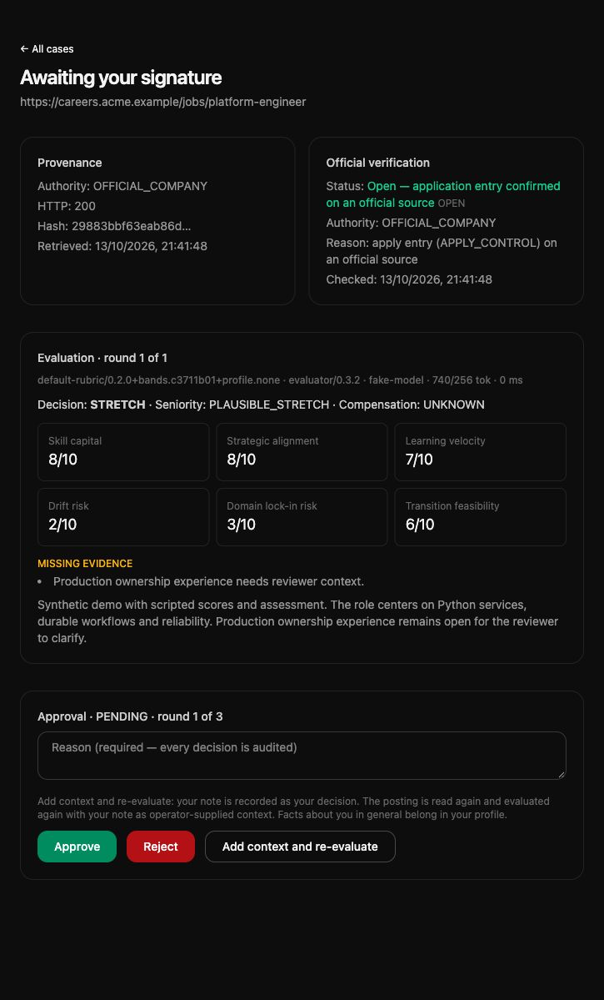
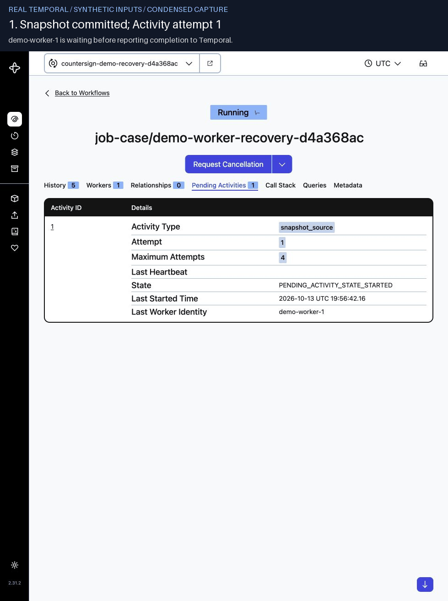

# Countersign

A production-oriented workflow system for one narrow agentic task: checking
whether a job posting is still open and worth applying to, and leaving a
record a human can sign off on.

The model reads and judges, code decides what counts as verified, and a
human makes the call. Each stage runs as a durable workflow step with
idempotent effects and an append-only audit trail, so a result can be
traced to the page, the rule, the model call and the human decision behind
it.

**Status:** the core workflow runs on real postings; the scheduled watch is
in a two-week live acceptance. [Current scope](#current-scope)
lists what is built; [Architecture v4](docs/job-search-agent-architecture-v4.md)
is the full design, and nothing in it is claimed before its code, tests and
telemetry exist.

Python · Temporal · FastAPI · PostgreSQL · Pydantic · Playwright · Next.js · Anthropic API



*A case awaiting sign-off, with synthetic data and a fake model.*

## Why this exists

It started with a small, specific failure. A general-purpose agent running
a scheduled job search kept recommending postings that were gone by the
time you clicked through. The answers carried links but no evidence:
nothing showed when a posting had last been seen open, or whether anything
had checked. A better prompt would have made the answers more convincing,
not more checkable.

Making them checkable is a systems problem rather than a prompting one:

- **A link is not evidence that a job is open.** OPEN needs an apply entry
  cited from an official source; anywhere else the same entry reaches only
  OPEN_THIRD_PARTY_ONLY. A cited closed notice, a past expiry date or a
  removed page closes the posting. These rules live in code, not in the
  prompt ([decision table](src/countersign/domain/verification.py)).
- **External calls fail.** Fetches and model calls retry as durable
  workflow steps, and a worker killed mid-step resumes without writing a
  second snapshot, evaluation or audit event.
- **The decision belongs to a human** and can arrive days later. The
  approval request waits as durable workflow state and pins the snapshot,
  verification and evaluation it was issued for.
- **Model output is attributable.** Readings and evaluations are stored
  with the prompt version, model, token counts and latency of the calls
  behind them; evaluations also carry the policy version.

## A production system, not a personal agent

Personal agents are built for breadth: one assistant for many tasks, with
the answer as the product. Countersign goes the other way. It runs one task
through a fixed pipeline, and the record is the product:

```text
URL → snapshot → page reader → status → evaluation → approval
      code       model         code     model        human
```

The model's autonomy is bounded on purpose. The only loop it drives is the
page reader's choice to render the page or follow a listed link, inside one
Activity and under step budgets enforced in code
([ADR-012](docs/adr/012-bounded-page-reader.md)); its claims count only
after citation checks. Besides approving or rejecting, the reviewer can add
context and send the case through another round of verification and
evaluation, up to three rounds in all
([ADR-014](docs/adr/014-evidence-loop-through-request-evidence.md)).

The question behind the project is not how to build a better job-search
assistant, but what it takes to make an agentic workflow recoverable,
reviewable, attributable and auditable.

## Current scope

Implemented (Slice 1 core plus parts of Slice 2):

- **Durable case workflow.** A pasted URL (with a mandatory `Idempotency-Key`)
  becomes one Temporal workflow: snapshot → normalize → verify → evaluate →
  human approval, with quarantine, needs-evidence, closure and seven-day
  expiry paths. A killed worker resumes without duplicate records.
- **Verification.** SSRF-guarded, DNS-pinned fetching and a bounded page
  reader: the model may render a page or follow a listed link under
  code-enforced budgets, and its claims count only after citation checks. A
  decision table sets status; HTTP 200 alone never proves OPEN
  ([ADR-012](docs/adr/012-bounded-page-reader.md), [ADR-015](docs/adr/015-render-network-policy.md)).
- **Source authority.** Known ATS hosts and company hosts the operator lists
  explicitly are official; boards and every other host are not
  ([ADR-005](docs/adr/005-official-source-authority.md), [ticket 002](docs/tickets/002-official-domain-mapping.md)).
- **Ashby API verification.** A posting the board's public API publishes is
  verified without a model call; the page's own closure evidence still wins
  ([ticket 003](docs/tickets/003-ashby-adapter.md)).
- **Scheduled watch.** Implemented and tested, running live under a two-week
  acceptance since 2026-10-14: it rechecks cases awaiting a decision and
  admits new postings from watched Ashby and Greenhouse boards into the same
  pipeline
  ([ADR-016](docs/adr/016-scheduled-watch.md), [ticket 004](docs/tickets/004-scheduled-watch.md)).
- **Human approval.** The system's APPLY_NOW framing needs an official OPEN;
  approving a posting without one is recorded as the reviewer's own
  verification ([ADR-013](docs/adr/013-human-attestation-for-unverified-postings.md)).
- **Evidence loop.** Reviewer context starts another round of verification
  and evaluation, up to three ([ADR-014](docs/adr/014-evidence-loop-through-request-evidence.md)).
- **Model gateway.** Structured output against Pydantic contracts, bounded
  schema repair, token/latency/version capture, and a deterministic fake
  provider for model-free runs.
- **Compensation signal.** Computed in code from extracted salary against
  configured bands; UNKNOWN whenever the figures cannot be compared.
- **Persistence and audit.** Deterministic IDs, dedup constraints and
  append-only audit events written in the same transaction.
- **Tooling.** Alembic migrations, Compose core profile, CI (ruff, pyright,
  import-linter, pytest with PostgreSQL, web typecheck/build), and workflow
  tests under Temporal's time-skipping environment, including duplicate
  delivery.

Not implemented yet (Slice 2+):

- further ATS adapters (Lever, SmartRecruiters), importing external scan
  reports, rechecks of approved cases, capability registry policy
  enforcement, prompt/policy version registry;
- authorization, failure inbox UI, OTel traces and cost dashboard;
- golden evals, calibration, policy promotion.

## Limitations

It has one operator and a small, real workload, and it does not show scale
(traffic, concurrency, horizontal scaling), multi-user security or team
engineering process. The recovery shown below is a worker killed on a single
host, not host failover. Known technical limits are listed in
[STATUS](docs/STATUS.md#known-limits).

## Why Temporal for one user

Temporal is heavy for a single-user tool, and it is here by design. The
problems it solves already exist at n=1: fetches and model calls fail and
must be retried without repeating their effects, an approval can wait up
to seven days, and a worker can die mid-step. Without Temporal, the same
guarantees would have to be rebuilt from cron jobs, status columns and
hand-written retry and timer logic.



*Worker recovery in the Temporal UI, condensed to 22 seconds (the
180-second timeout wait is cut and labelled). The worker is killed after the
snapshot commits; attempt 2 on a fresh worker continues the same run without
a duplicate record. Inputs and model output are synthetic; the workflow,
PostgreSQL and Temporal are real.*

The costs are accepted and written down: workflow code must stay
deterministic (the import boundary that keeps I/O in Activities is enforced
by import-linter), a Temporal service has to run, and idempotency still
belongs to the application because Activities run at least once.
[ADR-001](docs/adr/001-temporal-durable-workflow.md) records the decision
and the conditions for revisiting it.

## Architecture at a glance

```text
Next.js Web → FastAPI API → Temporal Workflow → Python Activities
                     │                            │
                     └──── PostgreSQL ←──────────┘
                                                  ↓
                                      Capability Registry
                                       ├─ official sources
                                       └─ model provider
```

A modular monolith with three process entrypoints: `web`, `api` and
`worker`. PostgreSQL is the system of record; Temporal is the only durable
workflow and background-job substrate. `countersign.domain` imports only
`countersign.contracts`, and `countersign.workflows` only those two, so all
I/O lives in Activities; import-linter enforces both rules.

```text
apps/web/          Next.js control-plane UI
src/countersign/   Python modular monolith
tests/             unit, workflow, integration and security tests
migrations/        Alembic migrations
infra/compose/     Compose definitions
docs/adr/          architecture decisions
```

## Where to look

- [`domain/verification.py`](src/countersign/domain/verification.py): the
  decision table that sets a posting's status.
- [`workflows/job_case.py`](src/countersign/workflows/job_case.py): one
  case's durable lifecycle, from snapshot to human approval.
- [`agents/page_reader.py`](src/countersign/agents/page_reader.py): the
  bounded page reader, the only loop the model drives.
- Decisions: [ADR-001](docs/adr/001-temporal-durable-workflow.md) (Temporal),
  [ADR-012](docs/adr/012-bounded-page-reader.md) (bounded reader) and
  [ADR-013](docs/adr/013-human-attestation-for-unverified-postings.md)
  (human approval); the [ADR index](docs/adr/README.md) lists them all.

## Running it

```bash
docker compose -f infra/compose/docker-compose.yml up --build
```

This starts the stack with a deterministic fake model; the web UI is on
:3001 and the Temporal UI on :8080. Live model setup, the local checks and
the crash-recovery demo are in [docs/development.md](docs/development.md).
