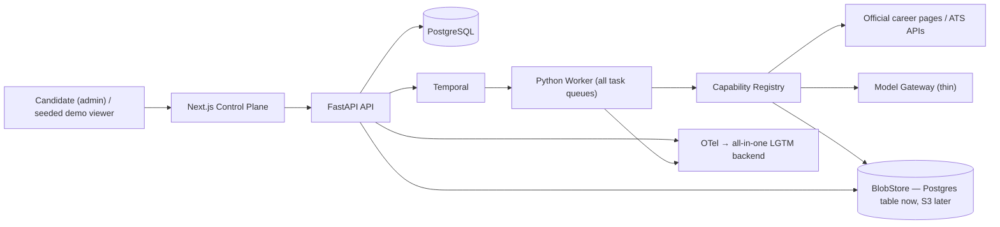
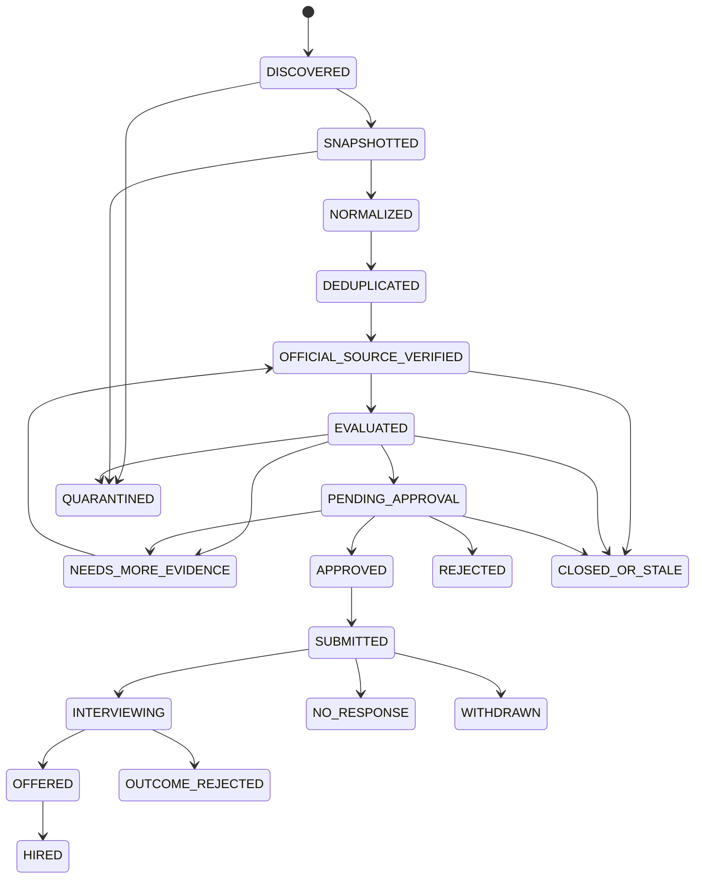

# Countersign — Architecture v4

> A production-oriented agentic workflow system for collecting, verifying, evaluating, and approving external job intelligence, scoped for a single operator and real operational use.

| Field | Value |
|---|---|
| Status | Proposed — implementation baseline |
| Updated | 2026-08-03 |
| Primary user | Candidate / job-search operator (single operator) |
| Architecture style | Durable workflow + typed tools + human governance |
| Runtime | Temporal + FastAPI + Python worker |
| System of record | PostgreSQL |
| UI | Next.js + TypeScript |
| Total implementation budget | **14 timeboxed weeks** (§24) |
| Monthly operating budget | Configurable and enforced (§22) |

---

## 1. Executive Summary

Countersign is a governed control plane that turns unreliable external job listings into reviewable **Job Intelligence Cases**. Its scope follows two constraints:

1. **The first deployment has one operator.** The system must become useful early, before every enterprise-shaped extension exists.
2. **Enterprise form without a real constraint behind it is a negative signal.** Experienced interviewers read unnecessary complexity as poor scoping judgment. Every component must survive the question *"why did you need this?"* with a domain answer, not a portfolio answer.

The multi-user identity stack, multi-tenancy, policy canary/shadow deployment, escalation chains, and autonomous learning are outside the current scope. Discovery uses inputs that exist across constrained job markets: paste-a-URL, curated watchlists, and official ATS APIs. Policy evolution is **human-proposed and machine-validated**; observability uses one backend; delivery slices have timeboxes and kill criteria; and sustained operator use is treated as operational evidence rather than hidden behind enterprise-shaped infrastructure.

The governed-loop thesis is unchanged:

```text
reviewer corrections (primary) + application outcomes (secondary)
        → calibration report → human-authored policy proposal → historical replay
        → golden regression → human approval → versioned activation → monitoring → rollback
```

Every job decision must have evidence. Every agent action must be recoverable, reviewable, attributable, and auditable.

---

## 2. The Load-Bearing Test

The single scoping rule for every component:

> **Does the constraint this pattern solves actually exist in this system?**

| Tier | Verdict | Components |
|---|---|---|
| **Load-bearing at n=1** | Build fully — the domain itself produces the problem | Durable execution & crash recovery; idempotency under retries; typed contracts + schema repair; source provenance + official verification; evals + regression gates; tracing + token/cost observability; human approval as durable state |
| **Principle real, spec was theater** | Build the principle, not the org chart | Server-side authorization (2 real roles, not 5); audit log; policy/prompt/model versioning |
| **Theater at n=1** | Cut; revisit only when a real constraint appears | OIDC multi-user identity; multi-tenancy; policy canary/shadow deploys; approval escalation chains; 12-runbook program; LLM-generated policy proposals from sparse outcomes |

Interview framing: components in tier 1 are assets (the honest answer to "why?" is "the domain needed it"). Components in tier 3 are liabilities (the honest answer would be "to look enterprise"). This document deliberately contains no tier-3 components.

---

## 3. Dual-Track Goals

The system serves two tracks simultaneously and fails if either is abandoned:

**Track A — a useful tool for a real operator.**
- First representative vacancy evaluated end-to-end by **end of Slice 1**.
- Scheduled scans of an operator-managed watchlist from **Slice 2**.
- Operator-approved cases and outcomes flow through the system from Slice 2 onward.

**Track B — portfolio evidence of agentic reliability engineering.**
- Demonstrated, not claimed: kill a worker mid-Activity and watch recovery; feed malformed model output and watch bounded repair; show the trace, the cost, the audit trail, the regression gate catching a bad prompt.
- Accumulated: sustained operational history — cases, cost data, incidents, and eval drift. This is the substance that enterprise *form* cannot substitute for, and it is only obtainable through real use.

---

## 4. What This System Does and Does Not Demonstrate

Stated up front, in the repository README and in interviews, because preemptive honesty is itself the signal.

**Demonstrates:**

- durable execution across crashes and multi-day human waits;
- governed, audited execution of typed external capabilities, with a built (but v1-empty) constrained path for model-proposed calls;
- evidence provenance and official-source verification of untrusted external data;
- deterministic policy gates around probabilistic model judgments;
- versioned prompts/models/policies with replayable evaluation and regression gates;
- latency, token, cost, and quality observability on every decision;
- governed, reversible policy evolution with a human in the loop;
- operational history from sustained use, exported only in privacy-safe aggregate form.

**Does not demonstrate (and never claims):**

- scale: traffic, concurrency tuning, horizontal scaling under load;
- multi-user adversarial security or compliance regimes;
- team engineering process (code review at scale, on-call rotation);
- causal learning from outcomes — hiring data at n≈tens is treated as calibration input for a human, never as training signal.

---

## 5. Non-Goals

- fully autonomous application submission;
- browser automation that violates a source's terms of service (this explicitly rules out LinkedIn scraping; manual export/paste from LinkedIn is fine);
- an unrestricted LLM with network, filesystem, or database access;
- a generic multi-agent framework, persona theater, or chatbot shell;
- silent prompt mutation based on individual rejections;
- claiming causal hiring insights from sparse, biased outcomes;
- rebuilding a general-purpose ATS or CRM;
- no multi-user identity provider, no multi-tenancy — v1 is **explicitly single-tenant with no inert `tenant_id` columns**: real tenancy is an isolation redesign, not a field, and a dead column pollutes unique constraints, queries, and repository APIs for nothing (ADR-009);
- no canary/shadow policy deployment — versioned activation + monitoring + rollback is the whole mechanism;
- no autonomous numeric policy changes generated by an LLM from outcome data;
- no observability distribution — one OTel-compatible backend container, not four.

---

## 6. System Context



### Trust boundaries

- **External sources are untrusted input.** HTML, JSON, redirects, and embedded instructions are data, never instructions.
- **The browser is untrusted for authorization.** FastAPI verifies identity and permission on every mutation.
- **The LLM is untrusted for control flow.** It emits typed proposals and tool intents; it never executes tools directly.
- **The worker is a scoped service identity** with least-privilege credentials.
- **Object storage holds sensitive evidence**; access via short-lived URLs and audited server-side authorization.

---

## 7. Technology and Runtime Shape

| Concern | Choice | Notes |
|---|---|---|
| Code shape | **Python modular monolith** + separate Next.js app | One installable package, two entrypoints (API, worker), one Docker image run as two Compose services; module boundaries enforced (see below) |
| Web | Next.js App Router + TypeScript + Tailwind | Playwright drives the e2e suite |
| API | FastAPI + Pydantic | Strict contracts at every trust boundary |
| Workflow | Temporal (self-hosted) | Only workflow engine; no second orchestration framework without a measured need |
| Worker | **One Python worker process** consuming all task queues | Queues stay logically separate (`discovery`, `verification`, `evaluation`, `calibration`); split into pools only when metrics justify it — this is the load-bearing test applied to deployment shape |
| Database | PostgreSQL | Unchanged; SQLAlchemy + Alembic |
| Blob storage | **Deferred behind a `BlobStore` interface** — PostgreSQL blob table first; MinIO/R2 later (§29) | Claim Check discipline is backend-independent: Temporal payloads and provenance carry `raw_object_key` + hash, never raw bodies |
| Retrieval | pgvector — deferred, derived index only | An index, never the source of truth |
| Model access | **Thin** gateway: route aliases, budgets, version capture | Slice 1 uses one provider called directly through the typed contract; the neutral abstraction is added in Slice 2, not before the first provider works |
| Telemetry | OTel SDK → **single all-in-one backend container** (Grafana LGTM-style image) | Replaces the 4-container collector/Prometheus/Tempo/Grafana set; Grafana Cloud free tier acceptable for the hosted demo |
| Local runtime | Docker Compose, **core profile = 6 containers** | `postgres, temporal, temporal-ui, api, worker, web`; `telemetry` is an opt-in profile |
| CI | GitHub Actions | Lint, unit, workflow-replay, integration, migration, eval gates — one Python package, one pipeline, one image build |

**Modular monolith rules.** One installable package (`countersign`), two entrypoints (`countersign.api`, `countersign.worker`), one image, two Compose services. Module boundaries are enforced with import-linter in CI, and the one that carries the architecture is Temporal's determinism seam: **`workflows/` imports only `contracts/` and `domain/`; all I/O exists only behind Activities.** The Next.js app stays a separate deployable consuming generated OpenAPI types.

---

## 8. Domain Model

### 8.1 Three kinds of truth

| Truth | Owner | Mutability |
|---|---|---|
| Source facts | Versioned snapshot + deterministic extractor | Append new observations; never rewrite history |
| Model assessments | Versioned evaluation run | New run supersedes; old result remains |
| Human decisions | Named actor + reason | Append-only |

An LLM output can never overwrite a source fact or a human decision. A human correction creates a new attributed override; the raw snapshot is immutable.

### 8.2 Core aggregates

`JobCase`, `SourceSnapshot`, `CanonicalJob`, `VerificationResult`, `EvidenceClaim`, `EvaluationRun`, `ApprovalRequest`, `HumanDecision`, `WorkflowRun`, `ToolExecution`, `ModelInvocation`, `PromptVersion`, `PolicyVersion`, `BenchmarkRole`, `OutcomeEvent`, `PolicyChangeProposal`, `CalibrationReport`, `EvalRun`, `AuditEvent`, `IdempotencyRecord`.

`PromotionDecision` folds into `HumanDecision`; `ApplicationArtifact` is deferred with the artifact pipeline. `BenchmarkRole` is a curated exemplar JD with an agreed evaluation and an archetype label, versioned as a policy artifact and used as a scoring anchor, golden-set member, and gap-analysis target (§17.1).

### 8.3 Identity and two-phase deduplication

Deduplication is explicitly two-phase so the system does not require an official URL before locating the official source:

- **Phase 1 — exact, early:** dedupe by `(source_adapter, external_job_id)` and by content hash. Deterministic, runs before verification.
- **Phase 2 — canonical merge, late:** after `locate_official_source`, a fingerprint over normalized company + title + location + official URL may **propose** a merge. High-confidence merges apply automatically with an audit event; low-confidence proposals wait for the operator. Manual merge/split requires a reason.

IDs are UUIDv7. Content hashes detect meaningful posting changes and trigger reevaluation.

### 8.4 Minimum provenance record

`source_id, canonical_url, source_type, authority_level, retrieved_at, http_status, content_type, content_hash, raw_object_key, extractor_name+version, robots_or_terms_policy, job_status_observed, redirect_chain, request_trace_id`. Large bodies live behind the `BlobStore` interface (a PostgreSQL blob table initially, object storage when volume justifies it — §29); provenance always records `raw_object_key` + hash, so a backend swap never rewrites history. Temporal payloads carry references, never raw bodies, regardless of backend.

---

## 9. Job Case State Machine

`SCHEMA_REPAIR_REQUIRED` is not a business state: it is an Activity-level retry condition recorded on the run. The evaluation check is a blind second opinion plus a deterministic comparator with explicit outcome paths (§13.3), and status enums are unified (§14).



### Transition rules

- Only successful official-source verification enters `OFFICIAL_SOURCE_VERIFIED`; only verified-`OPEN` cases can reach `PENDING_APPROVAL` as "apply now" (reviewer override requires a reason and is visually distinct).
- **Verification-by-disagreement runs inside the evaluation stage.** A blind second opinion evaluates the same Evidence Pack without seeing the evaluator's result; a deterministic `DecisionComparator` diffs the two typed outputs (decision, blocker sets, score gaps beyond thresholds). Agreement → `PENDING_APPROVAL` with both results attached; disagreement → a bounded cross-examination pass that does see both results and must cite evidence for every challenge, findings attached for the human; evidence coverage below threshold → `NEEDS_MORE_EVIDENCE`; contract failure after the repair budget → `QUARANTINED`. The mechanism never silently blocks — in a single-reviewer system its job is to arm the human, not replace them.
- Approval captures the exact verification, evaluation, prompt, model, and policy versions reviewed.
- Scheduled rechecks move stale pre-submission cases to `CLOSED_OR_STALE`; a later observation may reopen with full history preserved.
- Retry scheduling, schema repair, and manual-intervention flags live on `WorkflowRun` / `ToolExecution`, never on the case.
- State transitions use optimistic concurrency and append an audit event in the same transaction.

---

## 10. Durable Workflow Design

`JobIntelligenceWorkflow(case_id, contract_version)`:

```text
snapshot_sources → normalize → dedupe_phase1 → locate_official_source
→ dedupe_phase2_propose → verify_status → evaluate (incl. critic)
→ create_approval_request → wait for Signal (approve / reject / request-evidence)
→ finalize → schedule reverification
```

Ownership rules:

- Workflow code owns ordering, timers, Signals, Queries, cancellation, and state transitions; Activities own all non-deterministic work.
- Within the monolith, workflow modules import only `contracts/` and `domain/` (pure logic); DB, HTTP, and model access are reachable only from Activities — enforced by import-linter and Temporal's workflow sandbox. This is the monolith's load-bearing internal seam.
- Signals deliver approvals; duplicate Signals are idempotent via `approval_request_id + decision_version`.
- Schedules drive scans, stale rechecks, outcome reminders, and calibration reports.
- Continue-as-new bounds long-lived monitor histories; workflow changes follow Temporal versioning discipline.
- Approval requests store artifacts-under-review, allowed decisions, expiry and **reminder** timestamps. Escalation chains are cut: on expiry the request expires visibly (no implicit approval) and returns to the inbox. Resurrection condition: a second real reviewer exists.

Temporal task queues are the only background-job system (no Redis/Celery). Queue depth, schedule lag, and attempt counts are observable.

---

## 11. Discovery: Honest Inputs

Discovery inputs are ordered by reliability and implementation value:

1. **Paste a URL — permanent, first-class input.** Not a bootstrap hack. The primary discovery engine for this market is the candidate's own eyes (LinkedIn feed, newsletters, communities); the system's job is everything *after* discovery: snapshot, verify, evaluate, track. This must stay a one-action flow forever.
2. **Curated watchlist — a versioned policy artifact.** Companies + their ATS endpoints + role-family keywords. Editing the watchlist is a policy change: versioned, diffable, auditable.
3. **ATS APIs:** Greenhouse and Lever first (public JSON board APIs), Ashby/SmartRecruiters adapters as follow-ups. Read-only, external IDs preserved.
4. **ToS-clean feeds** (RSS, official APIs) — optional, per-source adapter with a recorded `robots_or_terms_policy`.
5. **Legacy scan-report import.** An `import_scan_report` adapter parses the pre-existing single-shot agent's markdown reports (company, title, URL, its scores) into discovery-only signals. Authority rules make this safe by construction: report claims are discovery data; official verification runs as usual. Accumulated historical reports become seed data and golden-set fixture material.

Explicitly out: automated scraping of sources whose terms do not permit it. A third-party posting enters the system by pasting the official company or ATS URL it points to, preserving official-source discipline.

**The report direction reverses on the way out:** a weekly scan digest is a rendered **export view** over persistent cases. The report is a view, not the artifact — that is the difference between this system and a one-shot markdown agent.

---

## 12. Source Provenance and Official Verification

This is the most domain-authentic subsystem and survives the load-bearing test completely.

- Authority order: official career page/ATS → company-controlled page → trusted board with working official redirect → aggregator (discovery only). Conflicts are never averaged; higher authority wins with the conflict visible.
- Status labels (canonical enum, used everywhere): `OPEN | OPEN_THIRD_PARTY_ONLY | UNKNOWN_STALE_RISK | CLOSED | EXPIRED`.
- Never infer "open" from HTTP 200; validate page/API semantics. Distinguish transient unavailability from closure; a 404 after a verified observation raises `CLOSED` confidence but may need a second observation.
- Reverify immediately before approval and before any submission; reverify active cases on schedule; detect material JD changes by normalized content hash and trigger reevaluation.
- Store extractor versions and cited text spans so any result can be reproduced.

---

## 13. Context Assembly and Model Boundaries

The evaluator receives a deterministic, versioned context package. This boundary is part of the architecture, not an implementation detail hidden inside a prompt.

### 13.1 Evidence Pack

A deterministic builder assembles the evaluation context from versioned inputs:

```text
EvidencePack:
  candidate_profile        (typed, versioned; salary fields redacted per §21)
  evidence_catalog_items   (typed claims with stable IDs, selected by role family)
  normalized_jd            (with span citations back to the SourceSnapshot)
  verification_summary     (status, authority, freshness)
  policy_rubric            (typed config — weights and thresholds, never prose)
```

The pack's content hash is recorded on every `ModelInvocation`; any evaluation is re-buildable from versioned inputs.

### 13.2 Prompt layout and caching

- **Stable prefix** (cache-friendly): system prompt template version + rubric + candidate profile.
- **Variable suffix:** JD, evidence pack, verification facts.
- Cache hit ratio is tracked as a first-class cost metric.

### 13.3 Budgets and stage routing

Per-stage token/cost budgets live in policy config: small model for extraction/classification, standard model for evaluation and the second opinion. The blind second opinion receives the same Evidence Pack through an independent prompt and never sees the evaluator's conclusion (anti-anchoring); the deterministic `DecisionComparator` then diffs the two typed results; only on disagreement does a bounded cross-examination pass see both outputs. Anti-anchoring and genuine critique are both preserved, and the extra model call is spent only where a disagreement exists to examine.

### 13.4 Deterministic / model split

Deterministic: URL normalization, allowlists, authority ranking, hashing, exact dedup, schema validation, status gates, score arithmetic over model-supplied dimensions, permissions, approval transitions, audit writes, retries/budgets, promotion mechanics.
Model-assisted (always versioned, always a proposal until validated): ambiguous field extraction, role-family classification, semantic duplicate proposals, fit/drift/velocity/seniority assessment, missing-evidence detection, blind second opinion and targeted cross-examination (§13.3), outcome-pattern *summaries* (numbers stay human-authored, §17).

### 13.5 Anchor exemplars

The evaluator prompt embeds **compact calibration cards** — condensed requirement/score summaries of `BenchmarkRole` cases, never full JDs (full JDs burn tokens and amplify anchoring bias) — selecting 1–2 cards matched to the case's role family. Cards live in the per-family stable prefix (§13.2) and are part of the policy package: swapping one is a policy version bump that goes through replay and regression like any other change. Anchors are a supplementary stabilizer; the primary defense against rubric drift is the golden regression suite (§18), not few-shot examples.

---

## 14. Contracts and Validation

All API requests, Activity I/O, tool calls, and model structured outputs use strict Pydantic models with generated JSON Schema; unknown fields rejected at trust boundaries.

Evaluation contract: enums are unified; claim fields are typed and cited; `compensation_signal` is computed deterministically; feasibility is explicitly ordinal rather than probabilistic. Score dimensions shown are from the shipped example rubric — operators define their own dimensions and weights as versioned policy (§17), kept outside the public repository.

```json
{
  "case_id": "uuid",
  "decision": "APPLY_NOW | STRETCH | WAIT | NETWORK | BENCHMARK | SKIP",
  "application_status": "OPEN | OPEN_THIRD_PARTY_ONLY | UNKNOWN_STALE_RISK | CLOSED | EXPIRED",
  "skill_capital": 8,
  "strategic_alignment": 7,
  "learning_velocity": 9,
  "drift_risk": 3,
  "domain_lock_in_risk": 2,
  "transition_feasibility": 6,
  "seniority_fit": "REALISTIC | PLAUSIBLE_STRETCH | LOW_PROBABILITY_STRETCH | BENCHMARK_ONLY | SKIP",
  "compensation_signal": "ATTRACTIVE | ACCEPTABLE | TRANSITION_DISCOUNT | CONCERNING | UNKNOWN",
  "salary_extraction": {"official": false, "source_authority": "THIRD_PARTY", "cited_span_id": "uuid"},
  "hard_blockers": [
    {"category": "EXPERIENCE_YEARS", "severity": "HARD",
     "cited_span_id": "uuid", "gate_outcome": "FAIL"}
  ],
  "missing_evidence": ["production deployment evidence"],
  "distinctive_assets": [
    {"asset_id": "candidate_evidence.language_fluency", "category": "LANGUAGE",
     "relevance": "HIGH", "evidence_claim_ids": ["uuid"]}
  ],
  "evidence_claim_ids": ["uuid"],
  "risk_flags": [
    {"category": "ORG_PLACEMENT_PRESALES", "severity": "MEDIUM", "cited_span_id": "uuid"}
  ],
  "confidence": 0.78,
  "policy_version": "job-eval/1.0.0",
  "prompt_version": "evaluator/1.2.0",
  "model_route": "reasoning-standard/2026-07"
}
```

Three rules keep the contract evidence-bound and honestly named:

- **Typed, cited claim objects.** `hard_blockers`, `risk_flags`, and `distinctive_assets` draw their categories from versioned vocabularies in the policy package and must cite either a snapshot span (`cited_span_id`) or catalog evidence (`evidence_claim_ids`) — free-form string arrays are exactly where models invent content. Blockers additionally record the deterministic gate outcome they triggered.
- **`compensation_signal` is not model output.** The model only extracts salary data with its source-authority label (`salary_extraction`); deterministic code computes the signal from the configured salary bands. This closes a real inconsistency: §13.1 redacts the candidate's salary from model context, so the model cannot be the party comparing against it.
- **`transition_feasibility` is an ordinal 1–10 judgment, not a probability**, and is labeled as such wherever it surfaces. It encodes that fit is bidirectional: requirement gates measure whether the candidate can pass, while feasibility also considers the relevance and scarcity of evidence-backed `distinctive_assets`. A years-based rubric alone misprices differentiators in both directions (§17.3).

Validation failure policy: reject → one deterministic schema-repair retry with the validation errors → optional fallback route → quarantine with raw response and attempt metadata preserved (redacted). Never parse business decisions from free-form prose.

---

## 15. Capability Registry

The Capability Registry governs **every external capability call** — scheduled scans and reverifications invoked deterministically by workflow code, as well as any future `ToolIntent` proposed by a model. It is the single enforcement point for schemas, authorization, allowlists, budgets, idempotency, and audit; model-proposed calls are a governed subset, not a special path.

Capability definitions carry: name+semver, **`invoked_by: WORKFLOW | MODEL | HUMAN`**, schemas, allowed workflows, required scope, risk level, allowed domains, timeout/retry/rate-limit, idempotency strategy, source authority, audit policy.

`invoked_by` answers the question an interviewer will ask: *when does the LLM actually choose a tool?* **In v1: never.** Fetching, verification, and normalization are invoked deterministically by workflow code; outcome recording and policy proposals are human/API commands. `MODEL` is a supported but empty class at launch — the `ToolIntent` path is built and tested, but no capability is registered to it until dynamic evidence-gathering shows a measured need. Résumé wording follows the facts (§25).

Initial capabilities:

| Capability | Invoked by | Risk | Notes |
|---|---|---|---|
| `fetch_official_job_page` | WORKFLOW | Medium | Domain allowlist, redirect and size limits |
| `query_greenhouse_board` / `query_lever_board` | WORKFLOW | Low | Read-only, external IDs preserved |
| `snapshot_discovery_result` | WORKFLOW | Low | Discovery only; never declares official status |
| `normalize_job` | WORKFLOW | Low | Pure typed transform where possible |
| `verify_job_status` | WORKFLOW | Medium | Requires official-source evidence |
| `evaluate_job_fit` | WORKFLOW | Medium | Workflow invokes the model via the gateway |
| `record_outcome` | HUMAN | Medium | Authenticated mutation, idempotency key |
| `propose_policy_change` | HUMAN | High | Creates a draft only; cannot activate |

`generate_application_draft` is deferred with the artifact pipeline.

Execution path: schema validation → allowlist → scope check → domain/risk/budget policy → idempotency → rate limit → execute → validate output → redact → persist + audit. SSRF protections block private, loopback, link-local, and metadata destinations; validate hosts across redirects; and enforce size and content-type limits. Webpage text is quoted data, never instructions. Secrets are resolved at execution time and never enter model context.

---

## 16. Access Control and Audit

The principle is real; the org chart was not.

- **Two real identities:** `admin` (the candidate — all human capabilities: approve, override, promote, configure) and `service` (the worker — explicitly scoped tool/API calls). Plus one **seeded read-only `viewer` demo account** whose only job is to prove server-side denial in the demo and tests.
- Authorization is enforced server-side on every mutation, Signal, and artifact access. The UI is not a security boundary.
- Session auth with hashed credentials. **OIDC is deferred** — resurrection condition: a second real human user.
- The role framework in the schema stays extensible; nothing else about multi-user identity is built.

Audit events carry `event_id, occurred_at, actor, action, resource, before/after hash, reason, request_id, trace_id, workflow_id, policy_version, authorization_decision`. They are append-only at the application layer; the deployed demo uses a restricted DB role; sensitive payloads are referenced by hash. Human approval is mandatory for accepting a case into the application queue, overriding status/blocker/evidence gates, promoting any version, enabling a high-risk tool, and changing retention rules.

---

## 17. Policy Versioning and Human-Authored Evolution

The policy package contains a profile, taxonomy, search policy, verification policy, rubric, thresholds, evidence catalog, prompt versions, and model routes. Each component is immutable after publication and pinned by an active manifest. Concrete operator policy values are supplied by a private deployment package; the public repository contains schemas and synthetic examples only.

**The proposal author is a human, and the primary feedback signal is the reviewer rather than the outcome.** At realistic single-operator volume, outcomes are sparse, delayed, and confounded; LLM-generated numeric policy changes would be statistical theater. Reviewer corrections are denser: each reviewed case produces a confirmation or an override, and an override is a direct, attributable statement that the system judged wrongly. Each override carries a typed reason category (`BLOCKER_MISSED`, `EVIDENCE_MISJUDGED`, `SENIORITY_MISREAD`, `STATUS_STALE`, …), so disagreement accumulates as labeled data from the beginning of operational use. Application outcomes remain a secondary, weaker signal.

```text
per case:   model evaluation → human confirm / override + typed reason
            → labeled disagreement record
periodic:   disagreement batch (primary) + OutcomeEvents (secondary)
            → CalibrationReport — descriptive only: every table shows its
              denominator; small segments are flagged "insufficient evidence",
              never averaged away; no causal claims
            → human-authored PolicyChangeProposal (weight/threshold diff)
            → historical replay → golden regression → deterministic gates
            → human approval → versioned activation → monitoring → rollback
```

The machinery — replay, regression gates, immutable versions, one-click rollback — is fully real and fully demonstrated. Only the *authorship* of numeric changes moves to the human, which is also the correct statistics at this sample size. An LLM may draft the calibration report's prose summary; it may never originate the numbers.

### 17.1 Benchmark roles

A `BenchmarkRole` is a curated exemplar JD with an agreed evaluation and an archetype label. One artifact, three uses:

1. **Scoring anchor** — injected as a versioned few-shot exemplar in the evaluator prompt (§13.5).
2. **Golden-set member** — each archetype contributes a characteristic evaluator trap (§18.1).
3. **Gap analysis** — diffing a benchmark's requirements against the candidate evidence catalog yields a prioritized evidence backlog: what evidence to develop next, judged against the whole target class rather than one application.

### 17.2 Slate diversity policy

The score's semantics stay pure — "how good is this role for the candidate" — because outcome calibration depends on it. Portfolio construction happens after scoring, in a deterministic `slate_policy`: per-role-family caps or diminishing-returns weighting on the weekly recommendation slate, with demotions labeled transparently in the UI ("shown lower for slate diversity"), never silently baked into the score. Asset scores are not portfolio weights.

Diagnosis precedes penalty: funnel telemetry distinguishes whether concentration (e.g., an all-FDE week) originates in discovery (watchlist/keyword bias), in evaluation (rubric bias), or in the market itself — three different prescriptions. Diversified applications also produce per-family calibration data, feeding §17.4.

### 17.3 Role families and bidirectional fit

- **Role-family classification uses responsibilities, not titles.** "FDE" spans genuine field engineering to relabeled implementation consulting; substance decides the family, and the golden set includes a case that punishes title-based classification.
- **Transition feasibility weighs both gates and scarcity** via `distinctive_assets` (§14): a verified differentiator may matter substantially in one role family and be irrelevant in another that has unrelated hard gates.
- **Decision thresholds are versioned policy.** Operators may change them through the normal proposal, replay, approval, and activation path; the evaluator never improvises a threshold for an individual case.

### 17.4 Calibration segments

Calibration reports segment by role family and archetype, because both the rubric's biases and the candidate's differentiators vary per family. Report discipline: every table carries its denominator; segments below a minimum n are flagged *insufficient evidence* rather than averaged away; and "consistent with" is the strongest allowed causal language — an ordinal score with sparse, confounded outcomes can be supported or contradicted, never proven calibrated.

Decision invariants: no `APPLY_NOW` without verified `OPEN`; hard blockers are always displayed; evidence coverage below threshold blocks approval; narratives may translate verified experience but never manufacture claims; salary data is labeled by source authority.

What never evolves automatically: truth separation, official-source priority, permission boundaries, mandatory approvals, audit immutability, privacy policy, and the ability to activate a proposal.

---

## 18. Evals and Regression Gates

### 18.1 Golden dataset — grown, not front-loaded

Curating 50 high-quality cases is substantial work that would stall early delivery. The staged target is:

- **Slice 4 gate: 20 semantic golden cases** — the LLM-judgment suite only: strong matches, seniority mismatches, drift/superficial-AI cases, conflicting-evidence and multilingual cases;
- **deterministic fixtures are counted separately**: duplicate/repost/closed/stale source sequences live in `tests/fixtures/sources/`, and prompt-injection/SSRF/malformed-payload cases in `tests/security/` — folding deterministic integration fixtures into the "golden eval" number would inflate it and weaken its credibility;
- **standing target: grow the semantic suite to 50** as real cases get redacted into fixtures — real operational history feeds the eval set, a better provenance story than synthetic bulk. Until then the honest name is *initial regression suite*, not "50 golden evals" (§25).

Initial public fixtures are synthetic, structure-preserving archetypes. Each is a `BenchmarkRole` and a characteristic evaluator trap:

- **Enterprise in-house archetype:** keyword-perfect technical content behind multiple hard experience and domain gates. Expected decision `BENCHMARK`; prohibited output `APPLY_NOW`. Tests hard-blocker recall — the over-enthusiasm failure.
- **Vendor field-engineering archetype:** hands-on evaluation, tracing, and tool-calling responsibilities inside a go-to-market organization, with softened qualification clauses. Expected decision in the `STRETCH` range. Tests drift false-positives and misreading of equivalent-experience language — the over-conservatism failure.
- **Platform-SaaS pseudo-field-engineering archetype:** AI vocabulary wrapping integration-engineering substance; model work is absent from the responsibilities. Expected: high reachability, low `skill_capital`, elevated `drift_risk`, and family classification by responsibilities rather than title. Tests superficial-AI detection.

Each case: source fixtures, expected status/decision *ranges*, mandatory blockers, prohibited claims, evidence links. Exact score equality is not asserted where judgment is fuzzy. Public-repo fixtures use minimal excerpts or structure-preserving rewrites of real JDs; raw snapshots of real postings stay in private storage.

### 18.2 Layers and gates

Evaluation layers cover contracts, deterministic behavior, extraction, decisions, evidence, reliability, operations, and security. Hard promotion gates require zero official-status safety violations, zero unsupported high-impact claims, zero authorization violations, a hard-blocker recall floor, decision-quality tolerance, latency and cost budgets, and a schema-validity floor.

CI uses a deterministic fake model for workflow tests; a separately budgeted live-model eval job runs for release candidates, with variance recorded rather than hidden.

---

## 19. Observability

One trace follows: HTTP request/Schedule → workflow → Activity → ToolExecution → ModelInvocation/external call → DB/outbox mutation. Trace context is carried in records without copying sensitive prompt content.

Required telemetry (trimmed to what gets used): workflow completion/failure/recovery counts; queue depth and schedule-to-start latency; Activity attempts and retry reasons; tool success/error rates by version; verification success and source freshness; model latency, tokens (incl. cached), and cost per case; prompt/policy versions on every evaluation; schema-repair and fallback rates; approval wait time, override rate, and override reasons by category; golden eval metrics; **outcome funnel by policy version** (see §23 for how this is framed).

Initial SLOs, all testable at n=1: no lost case after restart; zero duplicate side effects in fault tests; 100% of normal approvals carry fresh official verification; ≥99% contract validity after bounded repair; p95 scan-to-ranked < 10 min; p95 interactive API < 500 ms; 100% audit coverage of approvals, overrides, and promotions.

---

## 20. Reliability and Idempotency

Reliability policy defines transient, permanent, contract, authorization, budget, conflict, defect, and human-timeout failure classes with per-class handling. Timeout and retry defaults are versioned per capability; `Retry-After` is honored; non-retryable classes are explicit; exhausted work lands in a searchable failure inbox — no invisible infinite retry.

Idempotency: `Idempotency-Key` on mutating APIs; stable workflow IDs (`job-case/{case_id}/{generation}`); upsert/compare-and-set Activity writes; request fingerprints on tool executions; snapshot dedup by adapter+ID+hash; Signal dedup by request+decision version; transactional outbox for events. Temporal gives at-least-once execution; these rules give effectively-once business effects.

---

## 21. Security and Privacy

Trimmed to the controls that are load-bearing for one user plus a public demo:

- Data classes: public external (JDs), internal strategy (scores, policies), candidate confidential (CV, outcomes — encrypted, retention-controlled), secrets (secret manager only; never DB plaintext, logs, or prompts).
- Server-side authorization everywhere; scoped service identity for the worker; TLS in transit.
- PII redaction in telemetry, eval fixtures, and error payloads; candidate salary and contact data never enter model context unredacted.
- SSRF and prompt-injection controls per §15; CSP/CSRF/secure cookies on the web app; pinned lockfiles and dependency scanning; DB backups with restore drills.
- Configurable retention and deletion for candidate data (config-file driven is acceptable; a settings UI is not required).
- No inference or optimization on protected characteristics; calibration reports exclude them and flag proxies.

---

## 22. Cost Envelope

Cost is an explicit, configurable operating constraint. The following values are non-binding examples for a small single-host deployment:

| Item | Choice | Approx. monthly |
|---|---|---|
| Local development | Docker Compose | 0 |
| Demo hosting | One 4–8 GB VPS running the Compose stack, incl. **self-hosted Temporal** | Low-cost VPS tier |
| Blob storage | In PostgreSQL initially; R2/B2-class later | 0 |
| Observability | Self-hosted all-in-one or Grafana Cloud free tier | 0 |
| LLM usage | Capped per-route budgets, prompt caching, small-model tiering | Operator-defined cap |
| **Total target** | Enforced in versioned policy | **Deployment-specific** |

Temporal Cloud is not required for the demo. Self-hosting is a **cost and reproducibility choice, not a résumé claim**. A single VPS demonstrates worker and process crash recovery, not high availability; host failure is handled by backups plus a documented redeploy with defined RPO/RTO. Temporal UI, PostgreSQL, and the blob store are never exposed to the public internet. Budget breaches alert the operator through the existing budget-failure class rather than silently degrading.

---

## 23. Privacy-Safe Operational Evidence

Operational history is valuable evidence and sensitive data. Public artifacts follow these rules:

- **The public demo always runs on seeded, redacted fixtures.** Real data never appears in the hosted demo, regardless of how well the search is going.
- **Operational history is selectively exported:** a redacted cost dashboard, incident postmortem, regression report, or calibration report. Raw candidate profiles, application histories, and outcomes are never public artifacts.
- **Funnel numbers are triage telemetry, not a diary.** "500 discovered → 60 evaluated → 25 applied" is the system doing its job — SKIP precision at the top of the funnel is the headline metric, and hours-saved is its unit.
- **Response rates are reported with their confounds.** They reflect materials, timing, candidate profile, and company process as much as market conditions; the system reports them by segment, with denominators, and without editorializing.
- **Negative outcomes are consistency checks, not calibration proofs.** "Zero responses on cases scored `transition_feasibility ≤ 3` is *consistent with* the low scores" is the strongest allowed claim — an ordinal score with sparse, confounded outcomes cannot be proven calibrated, and overclaiming here would undercut the system's own evidence discipline. The system is never presented as hire-guaranteeing; it is presented as judgment-amplifying.

---

## 24. Delivery Plan: Timeboxed Slices

The reference delivery plan is **14 engineering weeks**. Each slice has a timebox and a kill rule; it is a planning example rather than an operator deadline.

### Slice 0 — Contracts and skeleton (1 week)
ADRs 1–5 (§28), repo skeleton, shared Pydantic contracts, base policy decomposition, threat-model notes.
**Kill rule:** if overrunning, ship 3 ADRs and start Slice 1 anyway.

### Slice 1 — One durable case (3 weeks)
Paste one official URL → snapshot → normalize → verify → **real single-provider evaluation through the typed contract** (fake model in tests) → durable approval in a minimal UI → worker-kill recovery demo. Compose core profile, migrations, CI, first integration test.
**Exit = Track A milestone: a representative vacancy evaluated end-to-end.**
**Kill rule:** UI degrades to a table + detail page; approval via API call is acceptable for the crash demo.

### Slice 2 — Governed intelligence (3 weeks)
Watchlist as policy artifact; Greenhouse + Lever adapters; legacy scan-report import adapter; scheduled scans and stale rechecks; capability registry with domain controls; thin model gateway (route aliases, budgets, version capture); prompt/policy versioning with anchor exemplars; OTel traces + cost dashboard.
**Exit = Claim Level 1 (§25) + scheduled scans running.**
**Kill rule:** ship Greenhouse only; defer Lever; keep single-provider direct if the gateway abstraction drags; the scan-report importer is cut first.

### Slice 3 — Human and operational governance (2 weeks)
Session auth, `admin`/`service`/seeded-`viewer`, server-side authorization tests, audit history, failure inbox with retry/quarantine, Case Detail + Approval Center, PII retention config.
**Kill rule:** retention stays config-file-only; audit + denial test are non-negotiable.

### Slice 4 — Evals and governed evolution (3 weeks)
20 semantic golden cases + CI regression gate; outcome + override-disagreement ingestion; calibration report (segmented per §17.4, denominators shown); slate diversity policy; benchmark gap-analysis report; human-authored proposal → replay → gates → promote/rollback in the Policy Lab.
**Kill rule:** replay on golden set only (defer full historical replay); 20 cases, not 50; gap-analysis report degrades to a manual diff document.

### Slice 5 — Deployed demo (2 weeks)
Seeded hosted environment on the §22 budget; README with §4's honesty section; demo script; ADR index.
**Kill rule:** a local Compose demo + screen recording replaces hosting if the VPS drags.

### Scope guard
No broad scraping, messaging integrations, CV generation, or memory layer is built until core gates are complete. The first convincing milestone is one representative case that survives a crash, cites an official source, produces a typed evaluation, and waits safely for a human.

---

## 25. Gate Matrix and Claim Levels

16 gates. Two honest résumé claims instead of one all-or-nothing threshold.

| # | Gate | M | Level | Evidence |
|---:|---|:---:|:---:|---|
| 1 | Recoverable workflow | M | 1 | Replay test + worker-kill demo |
| 2 | Idempotent effects | M | 1 | Duplicate-delivery and crash-window tests |
| 3 | Typed contracts at boundaries | M | 1 | Pydantic/JSON Schema + rejection tests |
| 4 | Failure taxonomy + retry policy | M | 1 | Per-class policy tests |
| 5 | Capability registry | M | 1 | Versioned definitions + policy tests |
| 6 | Source provenance | M | 1 | Snapshots, hashes, citations, extractor versions |
| 7 | Official status verification | M | 1 | Authority rules + scheduled recheck tests |
| 8 | Prompt/model/policy versioning | M | 1 | Immutable IDs on every invocation |
| 9 | Traces + token/cost telemetry | M | 1 | OTel trace + cost dashboard |
| 10 | CI + integration tests | M | 1 | API→workflow→DB end-to-end suite |
| 11 | Reproducible Compose stack |  | 1 | Core profile + smoke test |
| 12 | Migrations | M | 1 | Alembic upgrade tests |
| 13 | Server-side authz + audit | M | 2 | Authorization matrix + denial test + append-only audit |
| 14 | Semantic regression suite + gate | M | 2 | 20+ semantic cases (grows to 50), CI blocks unsafe candidates |
| 15 | Governed policy promotion + rollback |  | 2 | Replay, gates, activation, rollback demo |
| 16 | Deployed demo |  | 2 | Seeded hosted environment |

**Claim Level 1** (gates 1–12, end of Slice 2):
> Built a durable, human-governed agentic workflow system with governed execution of typed external capabilities, official-source verification, evidence provenance, and full trace/cost observability (Temporal, FastAPI, PostgreSQL, Next.js).

**Claim Level 2** (all M gates + 15, end of Slice 4):
> …extended with a versioned evaluation policy system: regression gates in CI, historical replay, and human-approved, reversible policy evolution informed by reviewer corrections and observed application outcomes.

No claim is used before its gates have code, tests, and telemetry behind it. Note the deliberate wording: not "tool use by an LLM" when no capability is model-invoked (§15); not "50 golden evals" before the semantic suite reaches 50; and not "driven by outcomes" when the primary signal is reviewer correction.

---

## 26. Portfolio Demo Script (8–10 minutes, seeded data)

1. Discover the same job via an aggregator fixture and the official Greenhouse fixture; show one canonical case with two immutable snapshots (two-phase dedup visible).
2. Kill the worker mid-verification; show Temporal resume with no duplicate side effect.
3. Return malformed model output; show bounded schema repair on the run record — case state untouched.
4. Open Case Detail: official status, cited evidence spans, the second opinion's comparator verdict and typed risk flags, policy/prompt/model versions, trace, tokens, cost.
5. Attempt approval as the seeded `viewer`; show server-side denial + audit event. Approve as `admin`; show durable continuation.
6. Flip the official fixture to closed; scheduled recheck moves the case to `CLOSED_OR_STALE`.
7. Import seeded outcomes and reviewer-override history; open the calibration report (denominators and insufficient-evidence flags visible); author a weight-diff proposal; replay + golden gates pass; activate; show ranking change; roll back.
8. Close on the cost dashboard and the §4 honesty section.

---

## 27. Repository Structure

```text
apps/
  web/                    # Next.js App Router + Tailwind; consumes generated OpenAPI types
src/countersign/             # Python modular monolith — one installable package
  contracts/              # Pydantic models, JSON Schema, enums (imports nothing internal)
  domain/                 # state machine, deterministic gates, score arithmetic (pure; imports contracts only)
  policy/                 # policy packages, anchors, slate policy, version manifests
  workflows/              # Temporal workflow definitions — imports contracts + domain ONLY
  activities/             # all I/O behind Temporal Activities
  capabilities/           # capability registry: definitions, executor, allowlists, source adapters
  gateway/                # thin LLM gateway: routes, budgets, schema repair, version capture
  api/                    # FastAPI app: routes, auth, audit (reaches Temporal via client)
  persistence/            # SQLAlchemy models, repositories, outbox, BlobStore
  telemetry/              # OTel setup and semantic conventions
  worker.py               # second entrypoint — Temporal worker
evals/
  semantic/               # LLM-judgment golden cases incl. the three named benchmark cases
  harness/                # replay and regression reports
infra/
  compose/                # core + telemetry profiles; one image, two services
migrations/               # Alembic
docs/
  adr/  demo/
tests/
  unit/  workflow/  integration/  e2e/   # e2e = Playwright
  fixtures/sources/       # deterministic source sequences: duplicate / repost / closed / stale
  security/               # prompt injection, SSRF, malformed payloads
```

Import boundaries are enforced with import-linter in CI. The rule that carries the architecture: `workflows/` may import only `contracts/` and `domain/` — Temporal's determinism requirement becomes a lint rule instead of a convention.

---

## 28. ADR Backlog

1. **[ADR-001](adr/001-temporal-durable-workflow.md)** Temporal as the only durable workflow engine (self-hosted for the demo).
2. **[ADR-002](adr/002-postgresql-system-of-record.md)** PostgreSQL as system of record; pgvector as derived index only.
3. **[ADR-003](adr/003-separate-three-kinds-of-truth.md)** Separation of source facts, model assessments, and human decisions.
4. **[ADR-004](adr/004-central-capability-registry.md)** Central capability registry governing all external calls; the LLM never executes tools.
5. **[ADR-005](adr/005-official-source-authority.md)** Official-source authority and stale-job policy.
6. **ADR-006** Human approval as Temporal Signal + persisted business record.
7. **ADR-007** Thin model gateway with versioned route aliases.
8. **ADR-008** Human-authored, machine-validated policy evolution: reviewer corrections as the primary feedback signal and outcomes as secondary evidence.
9. **ADR-009** The load-bearing test, explicit single-tenancy, and conditions for revisiting deferred capabilities.
10. **ADR-010** Transactional outbox and idempotency model.

---

## 29. Deferred Capabilities and Revisit Conditions

| Cut | Resurrection condition |
|---|---|
| OIDC multi-user identity, 5-role RBAC | A second real human user |
| Multi-tenancy (no inert columns kept) | A second real tenant — requires an isolation redesign (RLS or schema-per-tenant), not a retrofitted column |
| Policy canary/shadow deployment | Enough case volume that a bad policy version could do damage before a human notices |
| Approval escalation chains | A second reviewer |
| LLM-generated numeric policy proposals | Outcome volume with statistical power (hundreds per segment) |
| 12-runbook program | Kept as 4 core runbooks: stuck workflow, source adapter degraded, model outage/schema spike, bad promotion rollback |
| `generate_application_draft` + artifact pipeline | Core gates complete and Track A demand confirmed |
| 4 separate worker pools | Queue metrics showing contention |
| 4-container observability stack | Hosting or scale needs the separation |
| MinIO/S3 object store (`BlobStore` interface stays) | Snapshot volume or size makes Postgres blob storage awkward |
| pgvector retrieval index | Deterministic + model-assisted dedup measurably insufficient |

Deferred capabilities are not implied by placeholder schemas or inert infrastructure. When a revisit condition becomes true, the change requires an ADR and evidence that the additional complexity solves an observed constraint.

---

## 30. Final Architecture Test

For any recommendation, the product — not only the logs — must show where each fact came from, whether the role is verifiably open, which rules and versions produced the recommendation, what happened on failure, whether recovery duplicated effects, who approved and why, what it cost, and whether a new version regressed.

One question applies to every component before it is built:

> **If an interviewer asks "why did you need this?", is the honest answer about the domain — or about the résumé?**

Only the first answer justifies the component. A production-oriented claim is supported by a system whose parts solve real domain constraints and whose public evidence is safe, reproducible, and honest.
